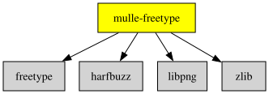

# mulle-freetype

#### ⌨️ mulle-freetype is a mulle-sde dependency convenience


# mulle-freetype

#### ⌨️ mulle-freetype is a mulle-sde dependency convenience

This project is nothing but a dependency convenience for mulle-sde projects
that use [freetype](https://freetype.org/) with [harfbuzz](//github.com/harfbuzz/harfbuzz).
It does not build a library itself.

### Linux

On Linux it uses the system supplied harfbuzz for faster compilation.

### Windows/Darwin

Build harfbuzz together with freetype.


| Release Version                                       | Release Notes  | AI Documentation
|-------------------------------------------------------|----------------|---------------
|  [](//github.com/MulleUI/mulle-freetype/actions) | [RELEASENOTES](RELEASENOTES.md) | [DeepWiki for mulle-freetype](https://deepwiki.com/MulleUI/mulle-freetype)


### You are here




## Add

mulle-freetype is a dependency convenience that does not produce a library.
It bundles [freetype](https://freetype.org/) and
[harfbuzz](https://github.com/harfbuzz/harfbuzz) with the proper build
settings (craftinfo) for use in mulle-sde projects.

Add it with `no-actual-build` so its subdependencies (freetype, harfbuzz) are
still traversed and built, but mulle-freetype itself is not:

``` bash
mulle-sde dependency add \
   --c \
   --marks no-actual-build,no-actual-link,no-all-load,no-cmake-loader,no-cmake-searchpath,no-header,no-import,no-link \
   github:MulleUI/mulle-freetype
```

Since mulle-freetype produces no library, you must also add `freetype` as a
link library in your project:

``` bash
mulle-sde library add freetype
mulle-sde library mark freetype no-header
mulle-sde library mark freetype no-all-load
mulle-sde library set freetype aliases "freetyped,freetype"
```

The aliases ensure the Debug build (`libfreetyped.a`) is found as well as
the Release build (`libfreetype.a`). On Linux, the system `libfreetype.so`
will typically be found first.

> **Why `no-actual-build` instead of `no-build`?**
> `no-build` removes the node from the craftorder entirely, preventing
> traversal of its sourcetree. `no-actual-build` keeps the node in the
> craftorder so freetype, harfbuzz and their craftinfo are built as part
> of your project, but skips running cmake on mulle-freetype itself.

## Install

Use [mulle-sde](//github.com/mulle-sde) to build and install mulle-freetype and all dependencies:

``` sh
mulle-sde install --prefix /usr/local \
   https://github.com/MulleUI/mulle-freetype/archive/latest.tar.gz
```

### Legacy Installation

Install the requirements:

| Requirements                                 | Description
|----------------------------------------------|-----------------------
| [harfbuzz](https://github.com/harfbuzz/harfbuzz)             | 
| [freetype](https://github.com/MulleUI/freetype)             | 
| [zlib](https://github.com/madler/zlib)             | 
| [libpng](https://github.com/glennrp/libpng)             | 

Download the latest [tar](https://github.com/MulleUI/mulle-freetype/archive/refs/tags/latest.tar.gz) or [zip](https://github.com/MulleUI/mulle-freetype/archive/refs/tags/latest.zip) archive and unpack it.

Install **mulle-freetype** into `/usr/local` with [cmake](https://cmake.org):

``` sh
PREFIX_DIR="/usr/local"
cmake -B build                               \
      -DMULLE_SDK_PATH="${PREFIX_DIR}"       \
      -DCMAKE_INSTALL_PREFIX="${PREFIX_DIR}" \
      -DCMAKE_PREFIX_PATH="${PREFIX_DIR}"    \
      -DCMAKE_BUILD_TYPE=Release &&
cmake --build build --config Release &&
cmake --install build --config Release
```


## Author

[Nat!](https://mulle-kybernetik.com/weblog) for Mulle kybernetiK  


